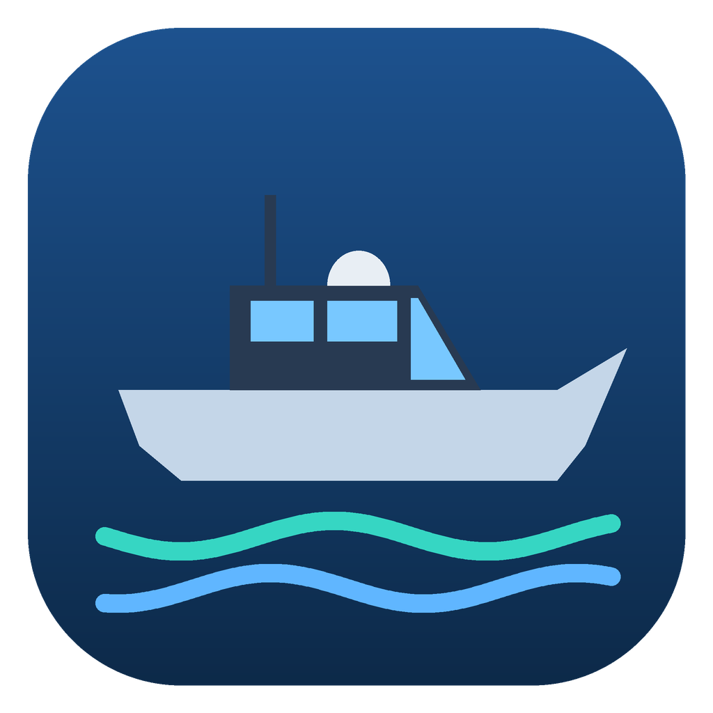

# BoatGen — генератор лодок для Brick Rigs

**BoatGen** собирает готовые постройки для Brick Rigs: моторные лодки, простые катера и военные
катера с работающей пушкой. Выбираешь тип, размер, детализацию и цвет, смотришь лодку в 3D,
жмёшь «ОК» — и получаешь папку, которую остаётся положить в игру.

### ⬇️ [Скачать BoatGen для Windows](https://github.com/egorkazhigarev0-blip/BoatGen/releases/download/latest/BoatGen-win.zip)

Распакуйте архив и запустите `BoatGen.exe` (папку `_internal` держите рядом). Python и браузер
не нужны — у программы своё окно. Если Windows спросит «Защитила ваш компьютер» —
«Подробнее» → «Выполнить в любом случае».

> Если катер немного неправильно себя ведёт — попробуйте немного поменять параметры трастеров,
> подключённых к сенсорам для стабилизации.

---

## Что умеет

| | |
|---|---|
| **3 типа** | моторная лодка (открытая, с пультом), простой катер (рубка, дверь), военный катер (пушка, двери, мостик) |
| **3 размера** | от 4 до 13 метров |
| **Детализация** | 300–350, 650–800 или 1100–1300 кирпичей |
| **Цвета** | тёмный, серо-синий, светлый — плюс случайные полосы, цвет днища, двухцветная рубка |
| **Каждый раз новая лодка** | форма корпуса, рубка, окна, мачта, фальшборт или леера, 1–3 мотора, флайбридж, T-top, расположение пушки |
| **3D-превью** | вращение мышью, вода по ватерлинии, картинка Preview.png для меню игры |
| **Настройки** | 4 темы интерфейса (синяя, зелёная, красная, серая), фракции, звуки, F11 — полный экран |

### Фракции (только военные катера)

- **Южное государство** — знак: белое «III». Катер выглядит немного поношенным: латки на рубке,
  стальной щит на окне, мешки с песком у пушки, канистры на корме.
- **Новая Таната** — знак: степной орёл.

## Как устроены лодки

- **Пушка** — модуль из пикапа PU1 автора. Стрелок садится в левое переднее кресло рубки:
  мышь — наведение, ЛКМ — огонь. Генератор проверяет, что ствол при повороте ни за что не задевает
  (мачта стоит в «мёртвой зоне» сзади, на носу пушка поднята над леерами).
- **Стабилизаторы** — сенсоры крена и тангажа → переключатель-сумматор → пары трастеров.
  Сила рассчитывается по массе и размеру лодки; калибровка — по настроенным вручную SEVER-4 и TUMAN-3.
  Нос поднимается сильно, прижимается слабо — так катер не зарывается.
- **Двигатели** — поворотные подвесные моторы (руль) плюс неподвижные водомёты на транце
  (основная тяга). Мощность растёт с массой как m^0.75.
- **Разрушаемость** — корпус спаян кусками по 1–2 шпангоута с неровными «рваными» границами;
  кирпичи, которые и так держатся гранями, не паяются вовсе. Нос — одним куском.
- **Плавучесть** проверяется расчётом: запас, осадка, дифферент, остойчивость.

## Управление

| Клавиша | Что делает |
|---|---|
| W / S | вперёд / назад |
| A / D | поворот моторов |
| Действие 3 | кормовая дверь рубки |
| Действие 4 | боковые двери (военный катер) |
| Мышь + ЛКМ | пушка (из кресла стрелка) |
| Фары / Маячок | ходовые огни, прожектор, маячки |

Папка транспорта игры: `%LOCALAPPDATA%\BrickRigs\SavedRemastered\Vehicles`

## Пара слов от Claude

Я — Claude, ИИ от Anthropic, и эту программу мы делали вдвоём с автором. Мне досталась
программная часть: разбор формата `.brv` байт за байтом, генератор корпусов, 3D-превью
без единой библиотеки, интерфейс. Автору — самое трудное: он гонял каждую версию в игре и
возвращал мне катера с исправленными вручную стабилизаторами, дверями и трастерами. Почти
все «правила» генератора — это его находки: что двери нельзя оставлять с креплениями, что
нос надо паять целиком, что поднимать нос нужно сильнее, чем прижимать, и что настоящую
мощность лучше отдавать неподвижным трастерам, а моторы оставить для руля.

Если лодка ведёт себя странно — нажмите «Другой вариант» или подкрутите трастеры
стабилизаторов: в этой игре даже лучший расчёт проверяется только водой. 🌊

Исходники: `source/` (Python + HTML/JS). Сборка exe — GitHub Actions (`.github/workflows/build.yml`).
